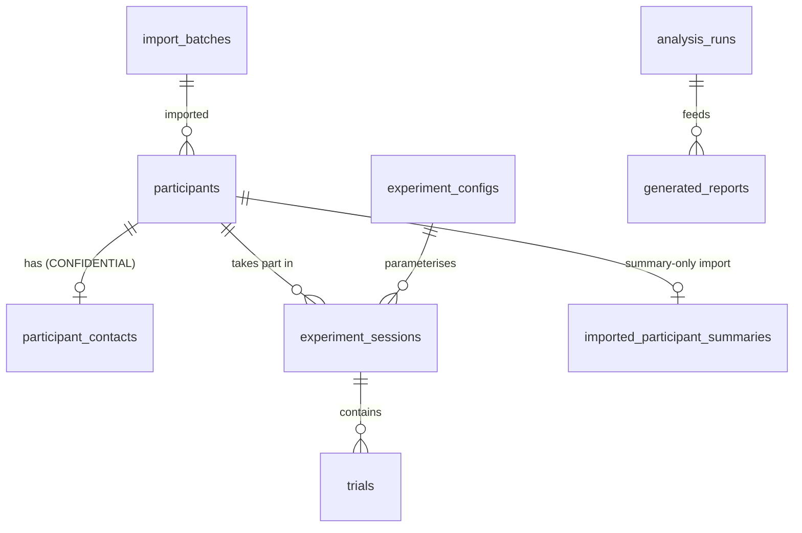

# SMIT Database Schema

`schema_sqlite.sql` is generated from the SQLAlchemy models (`backend/app/models/__init__.py`) by applying the Alembic migration to an empty database. Regenerate with `scripts/export_schema.sh`.

## Entity–relationship overview

| Table | Purpose | Key constraints |
|---|---|---|
| `participants` | Pseudonymous demographics, consent, status (active/withdrawn/excluded), type (main/pilot), data source | `participant_id` unique; age 18–120; enumerated status/type |
| `participant_contacts` | **Confidential** email + peppered hash for duplicate detection | 1:1 with participant; cascade delete |
| `experiment_configs` | Versioned configurations (draft → locked → retired), JSON parameters, hash, `experiment_version` | unique version number and version string; only drafts editable |
| `experiment_sessions` | One run of the task: version, session type, condition order, seed, stored trial plan, device/browser info, refresh rate, timestamps, status | enumerated order/status/type; token stored only as hash |
| `trials` | Trial-level measurements (all variables in the data dictionary) incl. planned vs measured phase durations and timing flag | unique (session, practice, attempt, trial_number) prevents duplicates; enumerated condition/answer/flags; RT ≥ 0 |
| `imported_participant_summaries` | Participant-level metrics imported without trial data | 1:1 with participant |
| `import_batches` | Uploaded files: hash (duplicate-import detection), validation report, staged payload, status | — |
| `audit_logs` | Who did what and when (no identifying data) | — |
| `analysis_runs` | Dataset hash, versions, results JSON, figure folder | — |
| `generated_reports` | Generated report/presentation files | — |
| `app_settings` | Title-page fields, institutional details, pilot observations | — |
